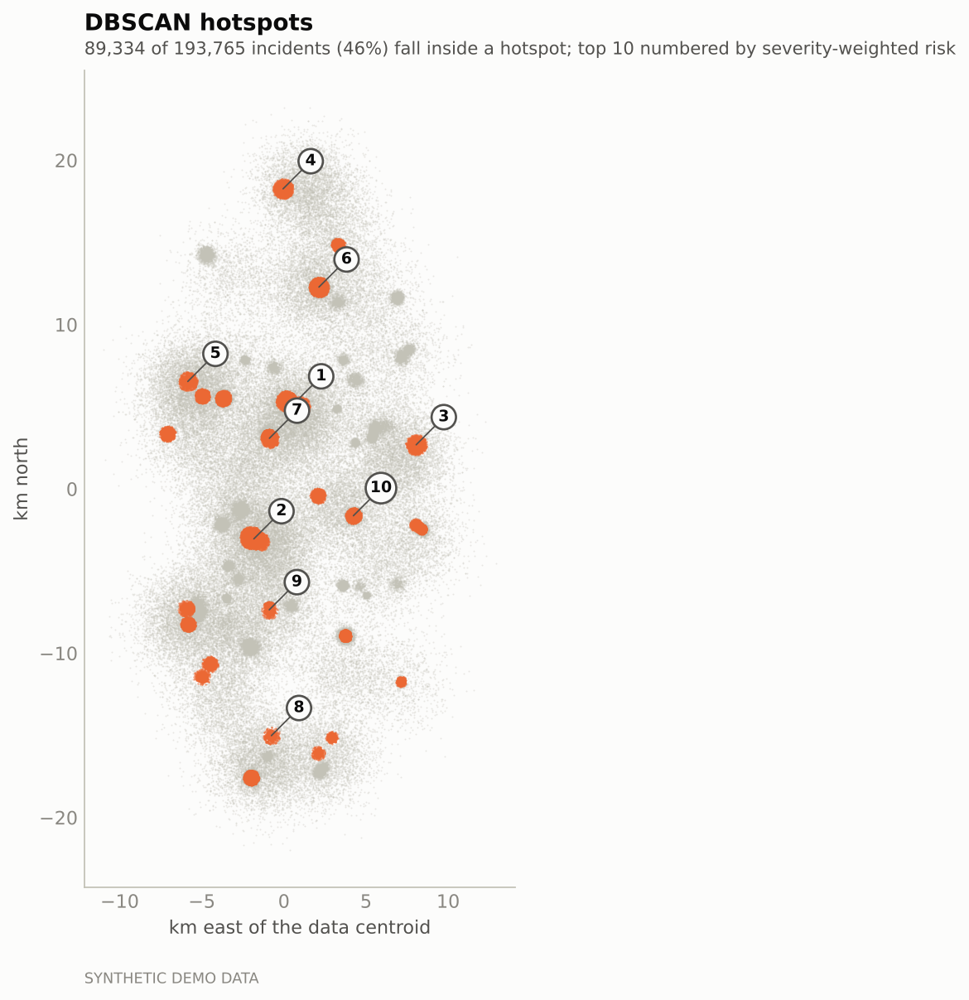
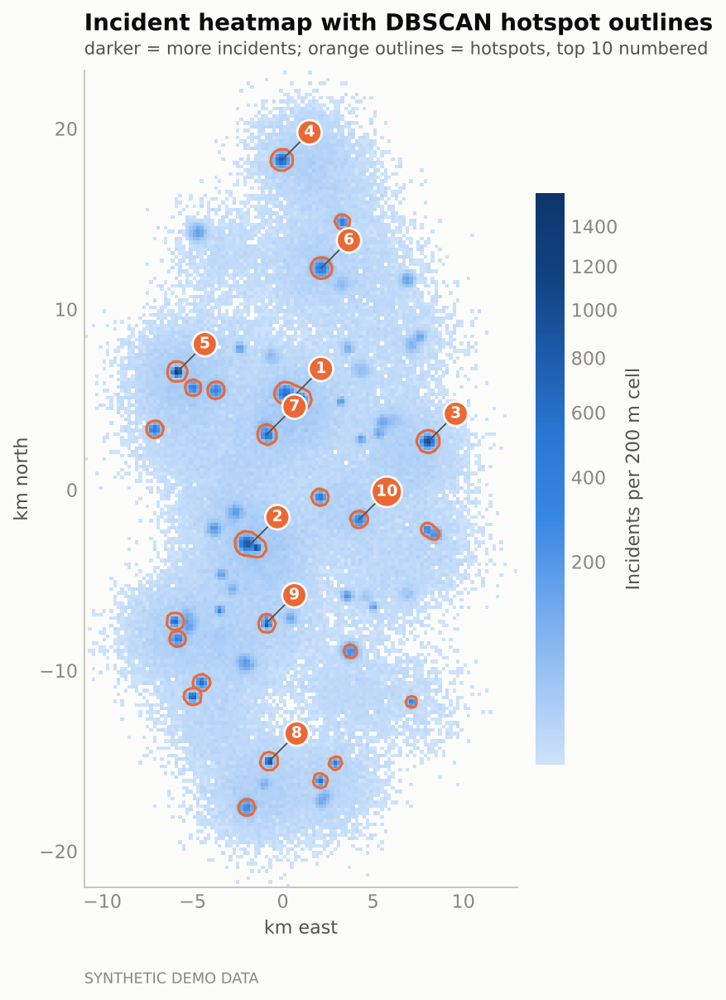
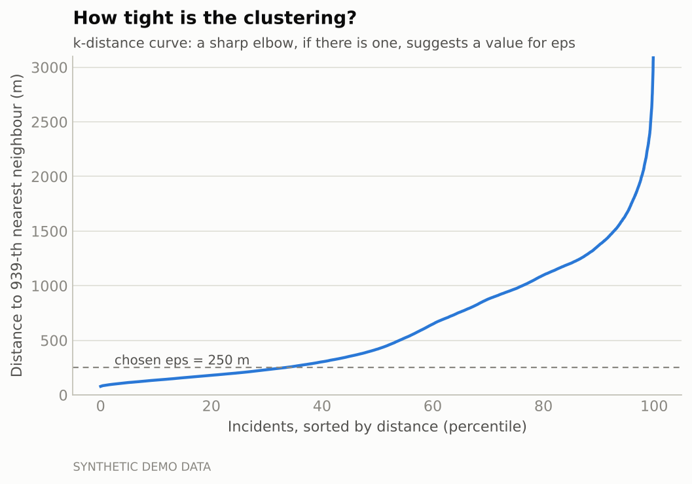
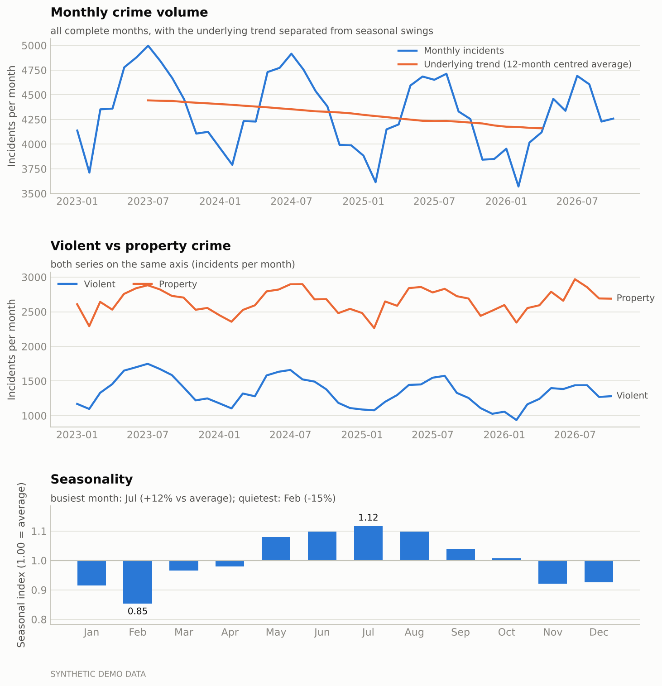
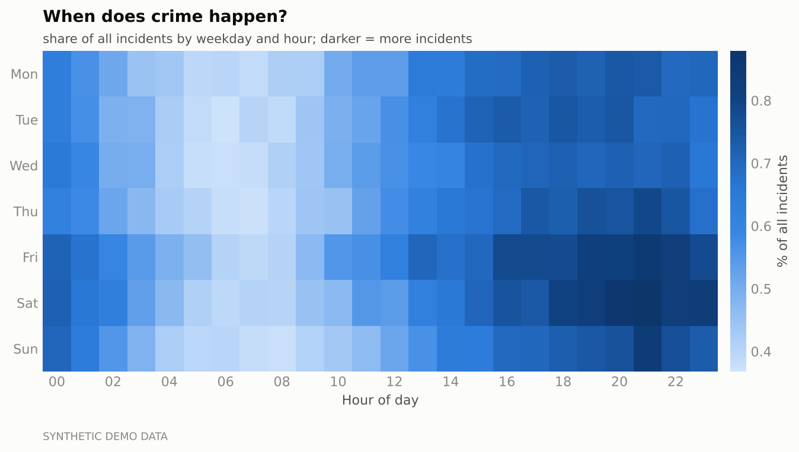
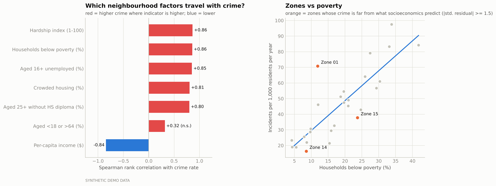
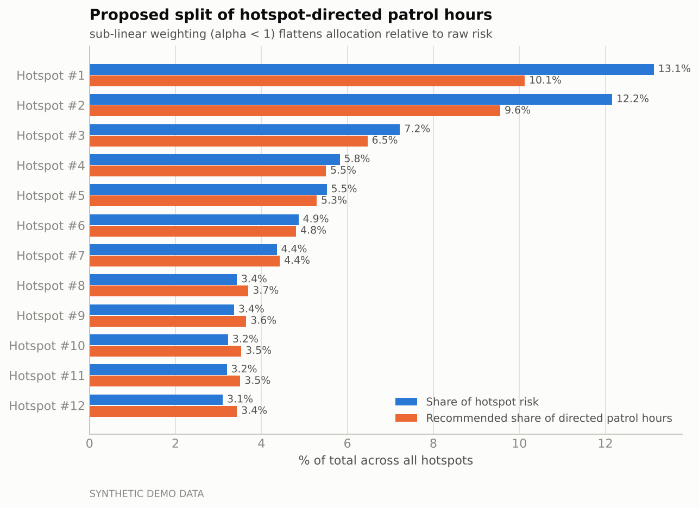

# Crime Hotspot Analysis: Chicago-style synthetic dataset

> **SYNTHETIC DEMONSTRATION DATA. The pipeline is real; the numbers below describe a simulated city, not actual crime.**

## 1. Key findings

- **Crime is spatially concentrated.** 46% of geocoded incidents fall inside 25 DBSCAN hotspots that cover only 5.9% of the occupied area. The top hotspot alone holds 6.1% of citywide severity-weighted risk.
- **Volume trend:** the seasonally-adjusted trend is -2.3% per year (p < 0.001); the last 12 complete months are -2.2% versus the 12 before.
- **Seasonality:** Jul is the busiest month (+12% vs an average month); Feb is the quietest (-15%).
- **Rhythm:** the busiest six-hour window citywide is 17:00-23:00 (32% of incidents); Fri has the most incidents of any weekday.
- **Neighbourhood context:** among the individual indicators, zone-level crime rates are most strongly related to *Households below poverty (%)* (Spearman rho = +0.86, p < 0.001, n = 28 zones). Crime rates are also spatially clustered (Moran's I = 0.32, p = 0.003).
- **Not everything is explained by disadvantage:** Zone 01 shows markedly higher crime than the socioeconomic model predicts, which points to drivers such as commercial activity or foot traffic.

## 2. Data and cleaning

Source: **synthetic Chicago-like incident reports (fabricated, seed 42) with deliberately injected data-quality errors**. Study window: Jan 2023 to Oct 2026. 198,712 clean incident records, of which 193,765 (97.5%) have usable coordinates. Records without coordinates stay in the time-series counts but are excluded from mapping and clustering.

| step | rows_affected | rows_remaining | note |
|---|---|---|---|
| raw rows loaded | 0 | 200,507 | starting point |
| exact duplicate rows removed | 997 | 199,510 |  |
| unparseable / missing dates removed | 399 | 199,111 |  |
| dates outside the study window / in the future removed | 399 | 198,712 |  |
| category text normalised (whitespace / case) | 1,978 | 198,712 | kept, not removed |
| missing category labelled UNKNOWN | 399 | 198,712 | kept, not removed |
| missing coordinates flagged | 3,963 | 198,712 | kept for time series, excluded from mapping/clustering |
| zero coordinates blanked | 594 | 198,712 | kept, no geometry |
| swapped lat/lon repaired | 584 | 198,712 | repaired in place |
| coordinates outside city bounding box blanked | 390 | 198,712 | kept, no geometry |
| clean rows ready for analysis | 0 | 198,712 | 193,765 of them have usable coordinates |

## 3. Spatial hotspots (DBSCAN)

Coordinates were projected to local metres. DBSCAN used **eps = 250 m** (about one to two city blocks) and **min_samples = 939**, i.e. a core point needs at least 10x the number of incidents that a 250 m radius would hold at the citywide average density. Incidents were snapped to a 25 m grid and clustered as weighted points (equivalent to DBSCAN on the raw points, but memory-safe). Clusters are ranked by severity-weighted risk, not raw count.

**Top 10 of 25 hotspots**

| rank | incidents | citywide risk share % | violent % | km² | peak 6h window | peak day | top crime types | last-12m change % |
|---|---|---|---|---|---|---|---|---|
| 1 | 11,800 | 6.1 | 31 | 2.41 | 19:00-01:00 | Fri | Theft 25%, Battery 17%, Deceptive Practice 12% | -3 |
| 2 | 11,210 | 5.6 | 28 | 2.09 | 19:00-01:00 | Sat | Theft 27%, Battery 15%, Deceptive Practice 12% | -4 |
| 3 | 6,948 | 3.3 | 24 | 1.33 | 20:00-02:00 | Fri | Theft 28%, Deceptive Practice 13%, Battery 13% | -4 |
| 4 | 5,707 | 2.7 | 22 | 1.33 | 18:00-00:00 | Tue | Theft 29%, Deceptive Practice 14%, Criminal Damage 13% | +7 |
| 5 | 5,057 | 2.6 | 30 | 1.11 | 18:00-00:00 | Fri | Theft 27%, Battery 16%, Deceptive Practice 12% | -2 |
| 6 | 4,719 | 2.3 | 23 | 1.27 | 19:00-01:00 | Sat | Theft 29%, Battery 13%, Deceptive Practice 13% | -3 |
| 7 | 3,846 | 2.0 | 34 | 1.07 | 18:00-00:00 | Sun | Theft 26%, Battery 18%, Assault 10% | +4 |
| 8 | 2,791 | 1.6 | 42 | 0.84 | 19:00-01:00 | Sun | Battery 22%, Theft 21%, Assault 11% | -11 |
| 9 | 2,740 | 1.6 | 42 | 0.84 | 20:00-02:00 | Sat | Battery 23%, Theft 21%, Assault 12% | -4 |
| 10 | 2,722 | 1.5 | 38 | 0.85 | 20:00-02:00 | Sat | Theft 21%, Battery 20%, Deceptive Practice 11% | -6 |

**Parameter sensitivity.** The hotspot count and coverage move with eps and the density multiple. The row marked *used* is the setting behind every map and table here; the other rows show how much the headline numbers would change. Check that conclusions about *where* the largest hotspots are survive neighbouring settings:

| eps (m) | density multiple | min_samples | hotspots | % incidents in hotspots | % area in hotspots | used |
|---|---|---|---|---|---|---|
| 150 | 6 | 203 | 43 | 53.4 | 7.0 |  |
| 150 | 10 | 338 | 31 | 44.8 | 4.4 |  |
| 150 | 15 | 507 | 26 | 38.6 | 3.1 |  |
| 250 | 6 | 563 | 34 | 54.3 | 9.1 |  |
| 250 | 10 | 939 | 25 | 46.1 | 5.9 | used |
| 250 | 15 | 1,408 | 17 | 35.2 | 3.4 |  |
| 350 | 6 | 1,104 | 25 | 52.7 | 10.5 |  |
| 350 | 10 | 1,840 | 19 | 42.3 | 6.3 |  |
| 350 | 15 | 2,760 | 7 | 25.2 | 2.7 |  |





The k-distance curve below is the classic diagnostic for choosing eps: a sharp elbow would mark where neighbours stop being 'close'. In this data the curve rises smoothly with no clear elbow, so it cannot pin eps down on its own. eps was therefore set on physical grounds (block scale) and its influence is shown in the sensitivity table above.



Interactive version with toggleable heatmaps (all, violent, night, daytime), hotspot popups and zone overlay: `outputs/maps/hotspot_map.html` (needs an internet connection for the basemap tiles).

## 4. Time-series analysis

Monthly counts over 46 complete months were decomposed into trend x seasonality x residual. The log-linear trend of the seasonally-adjusted series is -2.3% per year (R² = 0.78, p < 0.001).

**By crime type, last 12 complete months vs the 12 before:**

| crime_type | prev_12_months | last_12_months | change_pct |
|---|---|---|---|
| THEFT | 13,279 | 12,849 | -3.2 |
| BATTERY | 8,498 | 8,019 | -5.6 |
| DECEPTIVE PRACTICE | 6,114 | 6,262 | +2.4 |
| CRIMINAL DAMAGE | 5,405 | 5,293 | -2.1 |
| MOTOR VEHICLE THEFT | 4,047 | 4,477 | +10.6 |
| ASSAULT | 4,308 | 4,060 | -5.8 |
| NARCOTICS | 3,679 | 3,371 | -8.4 |
| BURGLARY | 2,884 | 2,819 | -2.3 |
| ROBBERY | 2,662 | 2,588 | -2.8 |





## 5. Socioeconomic correlates

Unit of analysis: 28 zones. Outcome: incidents per 1,000 residents per year.

| indicator | spearman_rho | p_value | n_zones |
|---|---|---|---|
| Hardship index (1-100) | +0.86 | <0.001 | 28 |
| Households below poverty (%) | +0.86 | <0.001 | 28 |
| Aged 16+ unemployed (%) | +0.85 | <0.001 | 28 |
| Crowded housing (%) | +0.81 | <0.001 | 28 |
| Aged 25+ without HS diploma (%) | +0.80 | <0.001 | 28 |
| Aged <18 or >64 (%) | +0.32 | 0.101 | 28 |
| Per-capita income ($) | -0.84 | <0.001 | 28 |

The indicators are collinear (largest variance inflation factor 11.6; above 5 is usually treated as a problem), so a regression with all of them gives unstable coefficients. Predictors were dropped one at a time (highest VIF first) until all VIFs were below 5, leaving **no_hs_diploma_pct, crowded_housing_pct, dependency_pct**. Which of several collinear indicators survives is somewhat arbitrary: read the model as 'neighbourhood disadvantage' jointly, not as a ranking of individual causes. OLS on log crime rate with standardised predictors gives R² = 0.76 (adjusted 0.73, n = 28):

| term | coef_per_1sd | std_err | p_value | pct_change_per_1sd |
|---|---|---|---|---|
| no_hs_diploma_pct | +0.233 | 0.093 | 0.019 | +26 |
| crowded_housing_pct | +0.237 | 0.085 | 0.010 | +27 |
| dependency_pct | -0.015 | 0.058 | 0.799 | -1 |

`pct_change_per_1sd` is the change in the crime rate associated with a one-standard-deviation higher value of that indicator, holding the others fixed. Spatial autocorrelation: Moran's I of the crime rate is 0.32 (p = 0.003); of the regression residuals -0.15 (p = 0.878), so little spatial structure is left unexplained.



**Read this carefully:** these are correlations between *places*. They do not show that disadvantage causes crime, and they say nothing about individual residents (ecological fallacy). With only 28 zones, statistical power is modest and individual coefficients are fragile.

## 6. Recommendations for police resource allocation

The proposal below is a transparent starting point, not an optimiser. Assumptions you should change with operational input: a budget of **1,000 deployable patrol hours per week** (illustrative), **70%** of it hotspot-directed, directed hours shared in proportion to risk^**0.75** (alpha < 1 spreads resources more than raw risk would, reflecting diminishing returns).

### 6.1 Hotspot-directed patrol

| rank | share of hotspot risk % | share of directed hours % | hours / week | emphasise window | window holds % of hotspot risk | status |
|---|---|---|---|---|---|---|
| 1 | 13.1 | 10.1 | 71 | 19:00-01:00 | 37 | stable |
| 2 | 12.2 | 9.6 | 67 | 19:00-01:00 | 35 | stable |
| 3 | 7.2 | 6.5 | 45 | 20:00-02:00 | 33 | stable |
| 4 | 5.8 | 5.5 | 39 | 18:00-00:00 | 35 | stable |
| 5 | 5.5 | 5.3 | 37 | 18:00-00:00 | 36 | stable |
| 6 | 4.9 | 4.8 | 34 | 19:00-01:00 | 34 | stable |
| 7 | 4.4 | 4.4 | 31 | 18:00-00:00 | 40 | stable |
| 8 | 3.4 | 3.7 | 26 | 19:00-01:00 | 39 | falling |
| 9 | 3.4 | 3.6 | 26 | 20:00-02:00 | 38 | stable |
| 10 | 3.2 | 3.5 | 25 | 20:00-02:00 | 39 | stable |

Within each hotspot, weight hours toward its own peak window (the 'emphasise window' column). The remaining 30% of hours stay as baseline zone patrol, shared by each zone's incident volume (full table: `outputs/tables/allocation_baseline_zones.csv`).



### 6.2 Timing

- **Time of day:** citywide, 17:00-23:00 holds 32% of incidents. Shift start times so that the heaviest staffing overlaps this window, and check each hotspot's own window in the table above because they differ.
- **Day of week:** Fri is the busiest day; weekends (Fri-Sun) carry 44% of incidents versus 43% if evenly spread.
- **Seasonal flex:** scale flexible/overtime hours by the seasonal index: Jul runs +12% above average, Feb -15%.

| metric | Jan | Feb | Mar | Apr | May | Jun | Jul | Aug | Sep | Oct | Nov | Dec |
|---|---|---|---|---|---|---|---|---|---|---|---|---|
| seasonal index | 0.92 | 0.85 | 0.97 | 0.98 | 1.08 | 1.10 | 1.12 | 1.10 | 1.04 | 1.01 | 0.92 | 0.93 |
| flex hours vs average | -8% | -15% | -4% | -2% | +8% | +10% | +12% | +10% | +4% | +1% | -8% | -8% |

### 6.3 Watch list and non-enforcement levers

- **Rising hotspots:** none exceeded +10% year over year.
- **Crime above what disadvantage predicts:** Zone 01. These look like activity-driven (commercial, transit, nightlife) rather than neighbourhood-driven problems, so pair patrol with place-management partners (business improvement districts, transit and licensing authorities, lighting and design reviews).
- **High hardship and high violent-crime zones:** Zone 03, Zone 20, Zone 25, Zone 05, Zone 13, Zone 04, Zone 18. Policing alone is unlikely to change the underlying conditions; prioritise these zones for place-based and social investments (lighting, vacant-lot remediation, youth and employment programmes, violence-intervention partnerships) alongside any patrol.
- **Evaluate, don't assume:** run any new deployment as a pilot with comparison areas, track displacement to adjacent blocks, and re-run this pipeline quarterly so hotspots, windows and trends stay current.

## 7. Limitations and responsible use

- **Reported crime is not all crime.** Reporting rates and enforcement intensity shape the data; categories like narcotics mostly reflect where police look. Allocating more patrol to high-count areas can raise recorded counts there and reinforce the pattern (a feedback loop). Treat hotspots as a prompt for judgement and review, not an automatic order.
- **Ecological fallacy and small n.** Zone-level correlations describe places, not people, and are based on few zones.
- **Parameter dependence.** DBSCAN results depend on eps and min_samples (see sensitivity table). Severity weights are illustrative, not an official harm index.
- **Geocoding.** 2.5% of records lacked usable coordinates and are absent from maps; if their absence is not random, hotspots may be biased.
- **Modifiable areal unit problem.** Zone boundaries are administrative; different boundaries could change the correlations.
- **SYNTHETIC DATA.** Every number above comes from a simulated dataset with built-in structure (including the link between disadvantage and crime). The *method* and *code* are the deliverable; the *findings* describe the simulation, not a real city. Re-run with `--source chicago` (or your own CSV) for real results.

## 8. Reproduce

```bash
pip install -r requirements.txt
python run_analysis.py                      # synthetic demo data
python run_analysis.py --source chicago     # real Chicago open data (needs internet)
```

All tables are in `outputs/tables/`, figures in `outputs/figures/`, interactive map in `outputs/maps/`.
